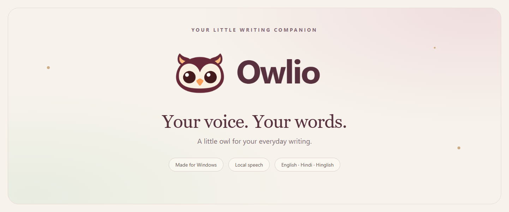

<p align="center">
  
</p>

<h3 align="center">Free, offline voice typing for any Windows app. No account, no subscription.</h3>

<!-- Demo GIF goes here (20 seconds: press shortcut, speak, text lands in VS Code or Slack):
<p align="center"></p>
-->

<p align="center">
  <a href="https://github.com/theshubzworld/OwliO/releases/latest"><strong>⬇ Download for Windows 10 / 11</strong></a><br>
  <sub>The installer is unsigned for now, so Windows SmartScreen may warn you: click <em>More info</em> → <em>Run anyway</em>. <a href="#-download">Verify the SHA-256</a>.</sub>
</p>

---

## ✨ Overview

**Owlio** is an open-source voice typing companion for Windows 10 and 11. Press a global shortcut, speak naturally, and Owlio types your words into whichever text field has focus: VS Code, Outlook, Slack, Notion, a terminal, anything.

It runs **local speech models (Whisper, Bodhan Flex and Parakeet TDT)** on your PC's CPU or NVIDIA GPU, so dictation works offline after setup. It covers 100+ languages, 27 Indian languages, and Hinglish with Devanagari or romanized output. Speed depends on the model, recording length and hardware.

**Use it as a guest.** Owlio needs no account. In guest mode every local feature works and no usage data is sent. Signing in is optional.

### Owlio vs Wispr Flow

| | Owlio | Wispr Flow |
| --- | --- | --- |
| Price | Free | Paid subscription, limited free plan |
| Works offline | Yes, with local models | No, cloud processing |
| Your audio leaves your PC | Not in local mode | Yes |
| Account required | No (guest mode) | Yes |
| Open source | Yes, MIT app code | No |
| Platforms | Windows | Mac, Windows, iOS, Android |

<sub>Wispr Flow details reflect its public pages as of October 2026 and may change.</sub>

<p align="center">
  <a href="https://github.com/theshubzworld/OwliO/releases/latest"></a>
  <a href="https://theshubzworld.github.io/OwliO/"></a>
  <a href="LICENSE"></a>
  <a href="#-contributing"></a>
</p>

<p align="center">
  <a href="#-download">Download</a> &nbsp;•&nbsp;
  <a href="#-key-features">Features</a> &nbsp;•&nbsp;
  <a href="#-supported-languages">Languages</a> &nbsp;•&nbsp;
  <a href="#-how-it-works">How it Works</a> &nbsp;•&nbsp;
  <a href="#-privacy-by-architecture">Privacy</a> &nbsp;•&nbsp;
  <a href="#-contributing">Contributing</a>
</p>

---

## ⚡ Key Features

- 🌐 **Works in Every Windows App**: Dictate anywhere you can type. Slack, Word, Notion, IDEs, Discord, Chrome, WhatsApp Desktop, terminal windows, and custom apps.
- 🔒 **On-Device Speech**: With a local model, speech recognition runs entirely on your hardware. Dictation works offline after the model download, and your recordings stay on your PC.
- 🚀 **Hardware Acceleration**: Choose lightweight CPU mode or lightning-fast NVIDIA GPU acceleration (CUDA 12.8 support).
- 🌍 **Over 100 Languages**: Automatic language detection across global languages (English, Spanish, French, German, Japanese, Mandarin, Arabic, and more), plus 27 regional Indic dialects and bilingual Hinglish.
- 🦉 **Your Companion, Your Way**: Customise your floating desk companion with multiple styles: Owl, Sleepy Cat, Little Cloud, Friendly Robot, Minimal Waveform, or Glowing Pebble.
- ✍️ **Intelligent AI Polish**: Keep pure verbatim speech with basic punctuation, or enable optional AI cleanup (via Gemini or Ollama) for smart formatting, disfluency removal, voice rewrites, and meeting summaries.
- 📝 **Word book & Labs**: Teach Owlio your spellings and spoken shortcuts, browse your dictations by day, and turn on extras like meeting notes and voice rewrites in Labs.

---

## 🌐 Supported Languages

Owlio was designed from the ground up for universal, multilingual communication. It preserves the natural script of whatever language you speak and detects language switches automatically.

### 1. Global Multilingual Whisper (100+ Languages)
Full speech recognition with automatic language detection, including:
- **Europe & Americas**: English, Spanish, French, German, Portuguese, Italian, Dutch, Russian, Polish, Ukrainian, Swedish, Turkish, Greek, Czech, Romanian, Danish, Finnish, Norwegian, Hungarian, etc.
- **Asia & Middle East**: Japanese, Mandarin Chinese, Cantonese, Korean, Arabic, Hebrew, Vietnamese, Thai, Indonesian, Malay, Persian, Tagalog, and more.

### 2. Regional Indic Languages & Dialects (via Bodhan Flex)
27 regional languages and dialects, including:
- Hindi, Bengali, Marathi, Telugu, Tamil, Gujarati, Urdu, Kannada, Odia, Malayalam, Punjabi, Assamese, Maithili, Bhojpuri, Konkani, Kashmiri, Dogri, Sindhi, Sanskrit, Haryanvi, Chhattisgarhi, Rajasthani, and more.

### 3. Bilingual Hinglish & Script Transliteration
- Seamless code-switching: mix Hindi and English naturally in the same sentence.
- Choose whether to output recognized words in native Devanagari script (`कल शाम की मीटिंग`) or romanized English letters (`Kal shaam ki meeting`).

### English dictation with Underdog Bark 3.0 Pro

Select **Speech & models → Change speech model → Underdog Bark 3.0 Pro · English**. Set the spoken language to English (or automatic detection), then choose **Set up model** / **Download**. The model has about 1.25 GB of weights and needs a Full speech package. Choose the NVIDIA GPU package in Advanced local speech for CUDA acceleration; CPU execution is also supported. Setup builds a separate runtime and connects it only after the model loads successfully.

Bark Pro is English-only and preserves spoken fillers. Owlio's optional writing cleanup and dictionary replacements run afterward. Whisper vocabulary prompts do not apply to Parakeet decoding. Recordings are processed in bounded, overlapping chunks to limit memory use.

Advanced Hugging Face imports accept CTranslate2 Whisper, Transformers Whisper, and Transformers **Parakeet TDT** checkpoints with safetensors and processor/tokenizer assets. Native NeMo archives, Parakeet CTC, GGUF and other architectures require a separate backend and are rejected. Imported language coverage comes from the model card; it is never inferred from the model name. Repository Python code is not downloaded or executed.

Source: [Bark Pro model card](https://huggingface.co/ConwayResearch/Underdog-Bark-3.0-Pro). The recommended checkpoint is pinned to revision `4b5c51e04aa8d16dda9ecdff71bc29f7360149e4`; its CC-BY-4.0 attribution is documented in [speech model notices](docs/speech-model-notices.md) and downloaded with the weights.

### Model links and licenses

The links below open the publishers' model pages. Built-in models are selected under **Speech & models**. For a custom Hinglish checkpoint, open **Advanced models**, paste its model-page URL and choose **Download URL**; a Full speech package is required for Transformers checkpoints. Model weights download separately and keep their own license terms.

| Model / download page | Use in Owlio | Publisher-declared license |
| --- | --- | --- |
| Whisper [tiny](https://huggingface.co/Systran/faster-whisper-tiny), [base](https://huggingface.co/Systran/faster-whisper-base), [small](https://huggingface.co/Systran/faster-whisper-small), [medium](https://huggingface.co/Systran/faster-whisper-medium), [large-v3](https://huggingface.co/Systran/faster-whisper-large-v3) | Built-in multilingual options; language coverage depends on the checkpoint. | MIT, as declared by these converted repositories; retain applicable upstream notices. |
| [Whisper large-v3 turbo](https://huggingface.co/mobiuslabsgmbh/faster-whisper-large-v3-turbo) | Built-in **Whisper large v3 turbo**. | MIT |
| [Underdog Bark 3.0 Pro](https://huggingface.co/ConwayResearch/Underdog-Bark-3.0-Pro) | Built-in English-only option; no Hindi/Hinglish support. | [CC-BY-4.0](https://creativecommons.org/licenses/by/4.0/legalcode.en); attribution required when sharing the model. |
| [Bodhan Flex](https://huggingface.co/bodhan-ai/indic-transcribe-flex) | Built-in option for 27 documented languages; request Hugging Face access and use an approved read token. | [Indic Open Model License v1.0](https://github.com/Bodhan-AI/bodhan-model-info/blob/main/licenses/indic-open-model-license/v1/Indic_Open_Model_License.md), plus upstream terms. |
| [Mayank Hinglish turbo](https://huggingface.co/mayank-dubey-ai/whisper-large-v3-turbo-hinglish) | Import by URL for Hindi/English and Hinglish dictation. | Apache-2.0 |
| [Oriserve Hindi2Hinglish Apex](https://huggingface.co/Oriserve/Whisper-Hindi2Hinglish-Apex) | Import by URL for Hindi/English and Hinglish dictation. | Apache-2.0 |
| [Trelis Hinglish preview](https://huggingface.co/Trelis/whisper-hinglish-preview) | Import by URL for Hindi, English and mixed Hindi-English speech. | Apache-2.0 |

**License essentials:** [MIT](https://github.com/openai/whisper/blob/main/LICENSE) requires retaining its copyright and permission notice when distributing copies. [Apache-2.0](https://www.apache.org/licenses/LICENSE-2.0) requires the license, applicable notices and change notices for modified files when redistributing. CC-BY-4.0 requires appropriate credit, a license link and modification disclosure when sharing. These licenses allow commercial use subject to their terms; publisher declarations are not a separate audit of training data or upstream rights.

**Bodhan Flex has additional conditions.** Built with Bodhan Flex from Bodhan AI / AI4Bharat. Its custom license permits local/commercial use subject to its terms, requires user-facing attribution when made available, restricts direct third-party hosting/API access unless approved or exempt, preserves the same license for distributed derivatives, and includes prohibited-use rules. Section 14 requires a separate license above 500 million monthly active users or US$250 million annual revenue, except for eligible public-interest entities. The upstream [NVIDIA Canary-1b-v2](https://huggingface.co/nvidia/canary-1b-v2) terms also apply. It must not be described as an unrestricted MIT/Apache model.

License declarations and primary terms reviewed on **25 October 2026**. See [model notices and upstream attribution](docs/speech-model-notices.md) for scope and details. Import support does not grant permission to use an arbitrary model.

---

## 📥 Download

Pre-built Windows 64-bit installers are published on the official [GitHub Releases](https://github.com/theshubzworld/OwliO/releases/latest) page.

| File | Platform | Architecture | SHA-256 Checksum |
| :--- | :--- | :--- | :--- |
| **[Owlio-Setup-1.0.27.exe](https://github.com/theshubzworld/OwliO/releases/download/v1.0.27/Owlio-Setup-1.0.27.exe)** | Windows 10 / 11 | x64 | `66DC7929FC395796FC909C6B11F25F4AB4F294267154EECB87E51FC4EBC06010` |

> **Note on Windows SmartScreen**: The installer is currently unsigned. If Windows SmartScreen displays a warning, click *More info* → *Run anyway*. You can verify the published SHA-256 hash above against your download.

---

## 🚀 How it Works

```
[ Your Voice ] ──> [ Floating Companion / Shortcut ] ──> [ Local Whisper (CPU/GPU) ] ──> [ Text Inserted in Active App ]
```

1. **Trigger**: Press your customizable shortcut (default: `F8`) or click the floating companion.
2. **Speak**: Talk naturally. The companion displays real-time soundwave feedback and listening status.
3. **Insert**: Release the shortcut or finish speaking. Owlio processes the audio locally and automatically types the formatted text into your cursor position.

---

## 🛠️ Guided Setup, No Manual Installs

You **do not need to install Python, PyTorch, or CUDA manually**.

On first launch, Owlio's interactive setup assistant handles everything in an isolated, private application directory:
1. **Lightweight CPU**: Whisper without PyTorch (~200 MB, minimal resource footprint).
2. **Full CPU**: Full PyTorch & Hugging Face Transformers models.
3. **NVIDIA GPU**: CUDA 12.8 GPU-accelerated transcription for the fastest local recognition.
4. **Cloud Mode**: Connect your own Groq or Gemini API keys if you prefer zero local disk usage.

Speech models download on demand and can be stored on any drive you specify in **Settings → Advanced Storage**.

---

## 🛡️ Privacy by Architecture

- **Audio Stays on Your Machine**: When using local Whisper models, all audio processing occurs exclusively on your CPU or GPU. No voice recordings are ever sent to remote servers.
- **Local Profile Storage**: Dictation history, personal dictionary entries, drafts, and custom snippets live inside your private Windows user profile (`%APPDATA%/Owlio`).
- **Optional Cloud AI**: Cloud speech recognition (Groq) or AI writing polish (Gemini / Ollama) is strictly opt-in and uses your own API keys.
- **No Account Needed**: Owlio runs in guest mode by default. Guests get every local feature and send no usage data at all.
- **Reporting Only If You Sign In**: Signing in is optional. Signed-in accounts accept the Terms of Use and send basic usage counts (activity, model and language categories, timings, success or failure). Audio, dictated text, API keys, window titles and your email are never included in usage events. Sign out at any time to return to guest mode. Read the full [Privacy Notice](https://theshubzworld.github.io/OwliO/legal/privacy-notice.html).

---

## 💻 Building from Source

To build and run Owlio locally on your development machine:

### Prerequisites
- Windows 10 / 11 (x64)
- [Node.js](https://nodejs.org/) 20.19+ or 22.12+
- [Python](https://www.python.org/) 3.11 for the local speech server (`npm run server:install`, then `npm run server`)
- [git](https://git-scm.com/)
- [.NET 8 SDK](https://dotnet.microsoft.com/download/dotnet/8.0) (for the Windows helper service)

### Clone & Run

```powershell
# 1. Clone the repository
git clone https://github.com/theshubzworld/OwliO.git
cd OwliO

# 2. Install dependencies
npm ci

# 3. Build the Electron application and TypeScript bundles
npm run build

# 4. Start the built app
npm start
```

### Packaging the Installer

```powershell
npm run package
```
Packaged outputs will be created in `release-artifacts/<version>/`. See the [Development Guide](docs/development.md) for deeper architecture documentation.

---

## 🤝 Contributing

**Contributions are warmly welcome!** Owlio is an open-source community effort, and we'd love your help making desktop voice typing fast, private, and accessible for everyone around the world.

### Ways You Can Contribute
- 🌍 **Language Improvements**: Test speech accuracy in your native language, report transcription edge cases, or contribute language-specific writing rules.
- 🎨 **Companions & UI Design**: Design new desk companions, SVG animations, soundwave visualizers, or accessibility themes.
- ⚡ **Performance & Core**: Optimize Electron startup time, improve memory usage of the background speech server, or benchmark new quantized models.
- 📖 **Documentation & Guides**: Improve setup walkthroughs, translate guides, or write tutorials for Linux/macOS community ports.
- 🐛 **Bug Reports**: Found an issue with a specific text field or app? [Open an issue](https://github.com/theshubzworld/OwliO/issues) with reproduction steps!

### Submitting a Pull Request
1. Fork the repository and create your branch from `main`:
   ```bash
   git checkout -b feature/my-amazing-feature
   ```
2. Make your improvements with clean, readable code.
3. Run the type check and build (the automated test suite is not published yet):
   ```bash
   npm run typecheck
   npm run build
   ```
4. Commit your changes with clear, descriptive commit messages.
5. Push to your fork and submit a Pull Request! We review PRs actively and appreciate every contribution.

---

## 📄 License & Acknowledgements

- **Application Code**: Licensed under the [MIT License](LICENSE).
- **Model Weights**: Speech checkpoints retain their respective licenses; some, including Bodhan Flex, have custom use restrictions. See [model links and license notes](#model-links-and-licenses).
- **Bundled Components**: The installer includes `LICENSE.txt` and `THIRD-PARTY-NOTICES.txt` (Electron, React, Supabase and other packages; regenerate with `npm run notices`). Bundled Bodhan Flex inference code is Apache-2.0; see [`vendor/bodhan_flex/`](vendor/bodhan_flex/).
- Speech models downloaded by Owlio (Whisper, Parakeet, Bodhan Flex and others) are not part of the MIT-licensed software and keep their own licenses. See [speech model notices](docs/speech-model-notices.md).

---

<p align="center">
  
  <br>
  <strong>Owlio</strong> · <em>Your voice. Your words. A little owl for your everyday writing.</em><br>
  <sub>Crafted for Windows with ❤️ by the open-source community.</sub>
</p>
